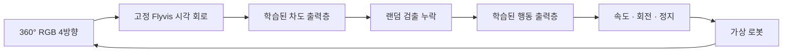

# 당진 우사 · 브라우저 시뮬레이션

제공된 두 도면, 10월 MCAP 8개와 추가 9월 MCAP 26개를 참고한 **도면 기반 근사 환경**이다.
5개 축사·부속 시설·진입로·외곽도로와 로봇의 360° 가상 카메라를 제공한다.
4동과 퇴비사 사이의 존재하지 않는 직선 연결로는 삭제했다.
퇴비사를 4동 쪽으로 20 m 옮기고 건물 옆으로 굽은 외곽길을 붙였으며,
1·2·3동과 4·5동 사이 중앙도로는 사용자 지정 **통행 금지**로 처리한다.
금지 구역을 y=5–178 m의 길이 173 m로 단축하여 남북 외곽길을 열었다.
외곽 순환로 약 1,030.9 m는 연결부의 접선까지 이어지는 닫힌 곡선이다.

최신 시설 배치는 **3동 앞쪽 입구가 위, 중앙도로 쪽 뒤끝이 아래**인 사용자 도식 기준으로
`실습장 → 도로 → 착유장 → 3동 뒤끝`, 실습장 아래 창고다. 일반 평면도의 동서 방향으로
이 도식을 읽지 않는다. `3동 뒤편 보기` 버튼은 이 방향으로 카메라를 맞추고 앞·뒤 입구를 표시한다.
시설 사이 길은 외곽 순환로와 연결하며, 3·5동 바로 아래의 기존 가로길은 중앙에서 끊어진다.
시설 간격과 굽은 길의 세부 좌표는 근사다. `site.json`, 렌더링·충돌 형상과 주행 격자에 같이 반영했다.

## 실행

저장소 루트에서, 이 워크스페이스에 준비된 Flyvis 런타임을 사용한다.

```bash
MPLBACKEND=Agg .cache/connectome-venv/bin/python tools/dangjin_sim_server.py --port 8765 --alias-port 8766
```

<http://127.0.0.1:8765/> → **로봇 실험** → **우사 전체 한 바퀴** → **추종 시작**.
8766 주소도 같은 서버와 모델을 사용한다.
모델 초기화에는 시간이 걸린다. 터미널에 Ready가 출력되면 사용할 수 있다.
종료는 실행한 터미널에서 Ctrl+C. 서버는 127.0.0.1에만 바인딩하며 ROS·실제 로봇 제어 API에 연결하지 않는다.

- 우사 전체 한 바퀴 / 퇴비사 옆 굽은 길 / 4동 동쪽 외곽 / 1·2동 외곽 / 중앙도로 접근 시험.
- 일시 정지·초기화·0.6 m 측면 이동·마주 오는 승용차 시험.
- 360° 파노라마, 진행 방향 영상과 계획 경로, 커넥톰의 4방향 차도 검출을 합친 파노라마 마스크.
- 로봇 화면 접기·펼치기. 패널을 접어도 진행 중인 시뮬레이션은 계속 동작한다.
- 새 시험마다 무작위 검출 구멍·전체 누락. 강도 선택, 시드 재현, 정지 후 재검출.
- 이동거리·속도·중앙 오차 RMS·추론 횟수·가상 시간·JSON 주행 기록 저장.
- 드래그 회전, 휠 확대, 시설 선택, 지붕·라벨·수목 표시, 보행 시점.
- 현장 기록에서 9월/10월 전환. LiDAR는 선택한 기록의 독립 센서 스캔.
- GPS 기록은 도면과 미정합인 별도 ENU 그래프.

서버의 `GET /api/status`, `GET /api/telemetry`는 모델과 추론 기록을 제공한다.
RGB 카메라 입력은 같은 로컬 서버의 `POST /api/step`으로만 전달한다.
이 API에 외부 정답 마스크나 경로를 넣으면 거부한다. 학습용 라벨 수집 API는 별도로 분리했다.
다른 컴퓨터에 옮기는 경우 `.cache` 런타임과 모델은 배포물에 포함되지 않는다.
[기존 Connectome 문서](../../docs/connectome.md)의 Flyvis 환경과 검증된 번들을 준비하고
`--bundle`, `--sha256`, `--device cpu|cuda`를 명시할 수 있다. Python 실행 환경에는
`flyvis==1.2.0`, `transformers==5.19.0`, PyTorch, NumPy, OpenCV 및 기존 planner 의존성이 필요하다.
기본 검출기는 `.cache/dangjin-connectome-road/`의 학습된 road readout이다.
`--road-model`로 그 경로, `--road-device mps|cuda|cpu`로 readout 실행 장치를 선택한다.
이전 SegFormer 기준선은 `--control baseline --road-backend segformer`를 명시했을 때만 사용한다. 자동 대체하지 않는다.

3D 보기만 실행하려면:

```bash
python3 -m http.server 8765 --bind 127.0.0.1 --directory environments/dangjin
```

이 정적 서버에서는 모델 추론이 제공되지 않아 추종 시작이 비활성화된다.
단일 파일 `dangjin-environment.html`도 보기·자료 확인용으로 사용할 수 있다.
내장 브라우저가 file URL 접근을 제한하므로 파일 URL 직접 실행은 검증하지 않았다.
단일 파일을 추론 서버의 HTTP 주소로 열면 같은 서버의 실제 모델을 사용할 수 있다.

## 커넥톰 직접 주행 실험

기본 서버는 `--control neural`이다. 검증된 Flyvis 회로 → 학습된 차도 출력층 →
학습된 행동 출력층으로 전진 속도·회전 속도·정지를 결정한다. **Pure Pursuit, 표면 경로 탐색,
검출 누락 시 강제 정지, 금지 구역/충돌에 따른 명령 덮어쓰기는 이 모드에서 실행하지 않는다.**
프레임 형식·유한 수치 검증과 사용자 일시 정지, 완주 후 시험 종료는 유지한다.



차도 출력층은 앞서 이 장면으로 학습한 가중치를 사용한다. 이번에 새로 학습하는 부분은
네 방향 차도 검출 결과만 받아 행동을 출력하는 CNN이며, **Flyvis 생물학적 연결 가중치는
고정**이다. 따라서 생물학적 운동 회로 전체를 재현했다고 주장하지 않는다. 현재 행동 모델은
현재 네 방향 검출을 이용하며, 장기 기억이나 관절 제어를 포함하지 않는다.
차도 인식은 RGB만 받는다. 행동 모델은 손상된 검출 마스크만 받으며
현재 위치·지도 형상·목표점·정답 조향·누락 여부 플래그를 받지 않는다.
완주 평가기는 지도에서 진행률·통과 게이트·이탈을 기록하지만 목표점을 계산하거나 행동 입력으로 보내지 않는다.
카메라 네 방향은 로봇 몸체에 고정하며 목표 쪽으로 가상 카메라를 돌리지 않는다.

동작 출력의 sigmoid/tanh가 속도 0–0.8 m/s와 회전 ±0.35 rad/s 범위를 정의한다.
정지 분류기의 argmax가 정지를 선택하면 0 명령을 내보낸다. 전체 누락을 검사하는 별도 정지
규칙은 없다. 모델이 정지하더라도 다음 관측을 계속 추론하므로 재출발도 새 모델 출력에 따른다.
화면의 짧은 선은 모델 명령을 일정하게 유지했을 때의 예상 궤적이며 제어 입력으로 쓰이지 않는다.
충돌·도로 이탈·금지 구역 검사는 관측 기록에만 남기며 가상 이동을 막거나 수정하지 않는다.
실제 로봇/ROS 경로에는 이 모드를 연결하지 않는다.

재학습은 로봇 실험 → 인식 모델 개발 → **주행 정책 학습 영상 수집** 이후 실행한다.
행동 가중치가 아직 없는 새 환경에서는 `--control baseline`으로 수집 서버를 먼저 시작한다.

```bash
MPLBACKEND=Agg .cache/connectome-venv/bin/python tools/train_connectome_policy.py --epochs 120
```

256개 도로 위치마다 세 가지 좌우/방향 변형을 촬영한다. 같은 위치의 세 변형은 같은 split에
배치하며 612개 시점으로 학습하고 156개로 검증한다. 교사 명령은 학습 중에만 도면의 순환로에서
계산한다. 학습 누락 시드 1000–1999, 검증 누락 시드 2000–2999를 분리한다.
회로·차도 모델·행동 모델·학습 자료의 해시와 지표는 `.cache/dangjin-connectome-policy-vision/training.json`과
서버 상태에 기록된다. 학습 영상은 실제 MCAP가 아닌 현재 합성 환경에서 렌더링한 영상이다.

영상 전용 모델은 `dangjin.drive_readout.vision.v2` 체크포인트만 로드한다. 이전 지도 목표 입력 모델과 혼용할 수 없다.
`validation/neural-drive-*` 기록은 이전 **지도 보조** 모델의 시험이며, 현재 영상 전용 모델의 성능 근거로 쓰지 않는다.
현재 모델의 영상 교체 검사와 새 브라우저 주행 기록은 `validation/vision-drive-*`에 별도 보존한다.

새 모델은 120 epoch 중 검증 성능이 가장 좋은 109번째 가중치를 사용한다. 검증 세트의 누락 포함 회전 오차는 0.0102 rad/s다.
156개 검증 입력을 모두 빈 검출로 바꾸면 학습된 정지를 선택했고, 영상을 뒤섞으면 평균 회전 출력이 0.184 rad/s 달라졌다.
이 검사는 실제 영상 입력이 행동에 영향을 주는지 확인하며 완주 시험을 대체하지 않는다.

영상 전용 모델의 보통 누락 완주 시험(시드 1364609034)은 1,032.34 m, 2,785회 실제 추론을 기록했다.
전체 누락 78회(197프레임), 부분 구멍 871프레임을 포함했고 모델이 78회 정지 후 재출발했다.
접촉·도로 이탈·금지 구역 진입은 0회, 순환 기준선 오차 RMS는 0.170 m, 최소 footprint 여유는 0.516 m였다.
[`vision-drive-normal-report.json`](validation/vision-drive-normal-report.json)에서 모든 프레임의 지도 목표점 부재와 모델 명령 그대로의 이동을 검사했다.

강한 누락 조건(시드 151084057)에서도 같은 가중치로 1,032.14 m, 3,250회 추론 후 완주했다.
전체 누락 162회(661프레임), 부분 구멍 1,578프레임과 모델 정지 후 재출발 162회를 포함한다.
접촉·이탈·금지 구역 진입은 0회, 순환 기준선 오차 RMS는 0.170 m, 최소 footprint 여유는 0.617 m였다.
[`vision-drive-severe-report.json`](validation/vision-drive-severe-report.json)과 두 시험의
[`vision-drive-summary.json`](validation/vision-drive-summary.json)에 결과를 보존했다.
두 전체 순환 시험에서는 승용차를 껐고, 승용차 교행은 별도 시험했다. 모두 현재 합성 환경의 결과이며 모든 누락 패턴이나 실제 로봇 성능을 보장하지 않는다.

```bash
MPLBACKEND=Agg .cache/connectome-venv/bin/python tools/validate_connectome_policy.py
node tools/validate_dangjin_neural_drive.mjs environments/dangjin/validation/vision-drive-normal-run.json
node tools/validate_dangjin_neural_drive.mjs environments/dangjin/validation/vision-drive-severe-run.json
```

**마주 오는 승용차**는 길이 4.3 m, 폭 1.8 m, 높이 약 1.65 m이며 18 m 앞 도로의 반대 차로에 생성된다.
로봇과 반대 방향으로 0.35 m/s로 움직인다. 생성 시 도로를 따라 정한 독립 궤적을 사용하며 로봇을 쫓아 재배치하지 않는다.
로봇의 검출 누락 대기 중에도 시뮬레이션 시간이 흐르면 이동하며 사용자 일시 정지에는 함께 멈춘다.
회전한 차량 외곽은 평가용 충돌 검사에 반영되고, 실제 센서 영상에도 렌더링된다.
이 차량 위치·궤적은 로봇 행동 모델에 전달하지 않는다. 차량 시험의 성공 여부와 차량 없이 한 바퀴를 도는 시험은 구분한다.
60초 교행 시험(보통 누락, 시드 18809933)에서 서로 지나갔고 접촉/이탈은 0회였다. 로봇 외곽과 차량 사이 최소 간격은 0.197 m였다.
로봇이 모델 판단으로 멈춘 11프레임 동안에도 차량의 시계와 위치가 계속 변했다.
[`vision-drive-oncoming-report.json`](validation/vision-drive-oncoming-report.json)은 이 한 번의 합성 교행만 검증하며 일반적인 장애물 회피 성공률은 아니다.

**로봇 따라가기**는 로봇 중심에서 정후방 7 m·높이 3.4 m에 카메라를 두고 전방을 바라본다.
이 관찰용 카메라는 몸체에 고정된 360° 인식 카메라에 영향을 주지 않는다.

이전 제어 방식과 과거 검증을 재현할 때만 `--control baseline`을 명시한다.
아래 누락 시험 설명의 별도 경로 검사/정지 규칙과 과거 완주 수치는 baseline에 해당한다.

## 검출 누락 시험

**랜덤 구멍 · 순간 전체 누락**은 기본으로 켜져 있다. 커넥톰의 실제 차도 검출 결과를 얻은
다음 일부를 지우고, 그 결과를 경로 계산과 화면 표시에 같이 사용한다. RGB 영상·신경 회로
입력·학습 자료·맵은 그대로다. 이 기능은 false negative를 인위적으로 만드는 스트레스 시험이며,
실제 현장의 누락 빈도나 지속 시간을 추정한 모델은 아니다.

- **새 시험**: 시작 위치로 돌아가고 새 uint32 시드를 만든다. 시나리오·강도·켜기 설정 변경도 새 시험을 시작한다.
- **패턴 재현 · 시드 → 재현**: 같은 강도와 시드로 누락 일정·구멍 모양을 재현한다. 시드 입력만 편집하면 아직 적용되지 않는다.
- **일시 정지·재개**: 시드와 가상 시간을 유지한다. 재생 속도는 누락 일정을 바꾸지 않는다.
- **옵션 끄기**: 실제 모델의 원래 검출 결과로 비교한다. 아래의 전체 순환 완주 기록은 누락 효과를 추가하기 전 기준선이다.

| 강도 | 부분 구멍 지속 | 전체 누락 지속 | 전체 누락 사이 정상 간격 |
| --- | --- | --- | --- |
| 약하게 | 0.5–1.5 s | 0.5–1.0 s | 22–40 s |
| 보통 | 0.5–2.5 s | 0.5–2.0 s | 10–22 s |
| 강하게 | 1.0–3.0 s | 1.0–3.0 s | 5–11 s |

시간은 **가상 센서 시간**이며 0.5 s 간격으로 관측한다. 네 방향의 구멍 위치는 서로 다르고,
구멍은 한 번의 burst 동안 유지된다. 전체 누락은 네 방향 모두를 지운다.
기존 기준선은 정지한 상태에서도 새 프레임을 추론하고 센서 시간을 진행하므로 일시적인 누락이 끝나면 다시
관측한 유효 경로로 출발할 수 있다. 검출이 없는 동안 이전 속도나 지도 경로로 계속 움직이지 않는다.
금지 구역·구조물·도로 경계 검사와 사용자 일시 정지는 유지되며, 구조물 위험으로 정지한 경우에는
자동 재출발하지 않는다. 누락 때문에 안전한 경로를 얻지 못하는 결과도 시험 결과로 남는다.

화면에 누락 종류·픽셀 비율·전체 누락 횟수·재검출 대기 시간을 표시한다.
브라우저 JSON 내보내기와 `/api/telemetry`는 `sensor_faults`에 버전, 시드, 강도와 프레임별
발생 ID, 원래 차도 픽셀 수·남은 픽셀 수를 기록한다. 서버 추론 횟수는 정지 중 재검출도 포함한다.
`tools/dangjin_sensor_faults.py`가 난수 일정을 관리하고, `sensor-fault-control.js`는 정지 후 재검출
가능 사유를 제한한다. 이 경로는 브라우저 시뮬레이터 전용이며 실제 로봇 제어에는 연결하지 않는다.

실제 모델을 실행한 브라우저의 보통·강한 누락, 시드 47 재현, 효과 끄기 시험을
[`sensor-fault-report.json`](validation/sensor-fault-report.json)에 기록했다. 전체 누락 동안 이동은
0 m였고 재검출 후 출발을 확인했다. 같은 시드의 첫 51개 관측에서 누락 일정이 일치했다.
보통 강도 시험은 구조물 쪽으로 향하는 계획 경로를 충돌 방지 검사가 차단하여 정지했다.
이 기록은 짧은 구간의 스트레스 시험이며 누락이 있는 상태의 전체 순환 완주 결과는 아니다.

## 기존 기준선의 인식·경로 제어

```text
로봇 pose → 6면 cubemap → 360° 카메라 → 0/90/180/270° RGB 투영
                                         └→ 고정 Flyvis 시각 회로
                                              └→ 신경 활동 → 학습한 차도 readout
진행 방향 RGB → 시간 상태를 유지한 Flyvis 광류             ↓
지도 경유점(순환 방향 안내) → 현재 인식 영역 안의 중앙 경로
                                                    ↓
현재 마스크 재검사 + 금지 구역 + footprint 검사 → Pure pursuit
                                                    ↓
0.5초 가상 시간 / 0.05초 이동 검사 → 다음 pose → 순환 진행 확인
```

[Flyvis 1.2.0](https://github.com/TuragaLab/flyvis)의 검증된 optical-flow 사전학습 회로를
고정하고, 그 신경 활동에서 차도를 읽는 convolutional readout을 이 합성 장면으로 학습했다.
각 투영은 grayscale BoxEye 수용기를 거쳐 실제 45,669개 뉴런 회로에서 0.02초씩 10회
적분한다. 34개 출력 세포형 × 721개 위치의 활동을 48×88로 보간해 readout에 제공한다.
readout으로 들어가는 RGB 우회 연결은 없다. 검출용 회로는 회색 정상 상태에서 시작하고,
시간을 이어가는 광류 회로 상태와 분리한다. 회로 가중치는 공유한다.

128개 위치 × 네 방향 = 512개 RGB/라벨 쌍을 사용한다. 학습 408장과 검증 104장은
위치 단위로 나누어 같은 위치의 네 방향이 서로 다른 split에 섞이지 않는다.
평탄한 단색 영상 8장을 추가 음성 표본으로 사용한다. 맨홀 뚜껑은 주행 가능한 표면에 포함한다.
**주행 중에는 정답 마스크를 렌더링하거나 보내지 않는다.** 서버의 인식기는 RGB만 받으며,
좌표·도로 형상은 인식기에 들어가지 않는다. 검증 지표, 신경 활동을 평균값 또는 공간
뒤섞기로 바꾼 ablation, 학습 설정은 모델의
`simulation-training.json`에 보존한다. 실제 MCAP 사진에는 라벨을 만들어 학습시키지 않았다.

기존 pretrained optical-flow decoder도 실제 실행하고 SHA-256을 검증한다.
신경 활동에서 읽은 차도 마스크가 경로 후보를 제한하고, 커넥톰 광류가 후보 평가에 참여한다.
새 road readout은 공학적으로 추가 학습한 분류기이며 생물학적 연결 자체를 새로 학습한 것은 아니다.
학습된 waypoint head로 조향 명령을 출력하지 않는다.

지도는 6 m 앞 경유점으로 순환 방향과 가상 카메라의 시선을 안내한다. 지도 경로를
그대로 로봇 위치에 대입하지 않는다. 현재 인식 영역에서 얻은 경로가 없으면 정지한다.
제어는 인식 경로를 로봇 좌표로 변환한 뒤 Pure pursuit로 계산한다.
시뮬레이터의 알려진 pose를 사용하며 SLAM·실제 GPS 자기 위치 추정은 포함하지 않는다.

카메라는 높이 1.6 m, 파노라마 768×384, 가상 시점 480×270 / 수직 FOV 90°다.
360° 영상에서 회전한 진행 방향을 골라 코너를 미리 보고, 그 방향을 기준으로 90° 간격의
네 투영을 모두 검출한다. 수평 방위각 360°를 덮지만 수직 시야는 투영마다 90°다.
관측하지 못하는 파노라마 위·아래 극점 부근은 회색으로 남긴다. 전방 마스크가 추종 입력이며,
나머지 방향의 결과도 파노라마에 표시한다. 원본 CameraInfo의 왜곡은 합성 카메라에 적용하지 않는다.
지도 안내선·금지 구역 색상·계획 경로·이동 궤적은 카메라 영상에서 제외한다.
금지 구역은 실제 노면 위에 칠한 장애물처럼 인식시키지 않고 별도 경로 정책으로 검사한다.

`validation/connectome-road-training.json`에 보존한 합성 검증 결과:

| 항목 | 결과 |
| --- | ---: |
| 학습 / 검증 RGB 영상 | 408 / 104장 |
| 검증 차도 IoU / precision / recall | 98.13% / 99.17% / 98.95% |
| 신경 활동을 평균값으로 대체한 IoU | 0.00% |
| 신경 활동 공간 위치를 뒤섞은 IoU | 2.08% |

검출용 회로 실행이 광류의 시간 상태를 바꾸지 않는지 실제 가중치로 확인했다.
실행 전후의 다음 광류 출력 차이는 0이며, 검은 카메라 입력의 차도 검출 픽셀은 0이다.
파노라마 좌우 방향과 미관측 극점도 검사했다 (`validation/connectome-road-contracts.json`).
이 지표는 동일 합성 환경의 별도 시점에 대한 결과이며 실제 영상의 일반화 성능을 의미하지 않는다.

속도 상한은 0.8 m/s, yaw 상한 0.35 rad/s, 원형 footprint 반경은 0.65 m다.
곡선에서는 감속하며 추론 대기 중 가상 시간은 멈춘다. 다리·접촉·경사·미끄러짐 물리는 없다.
보행 시점과 부지 투어는 관찰용 카메라다. 건물 내부는 보수적으로 장애물 처리한다.
사일로 지지대·가로등·통과 구조물 기둥도 렌더링과 동일한 좌표로 충돌 검사한다.
근사 배치한 가로등은 곡선 도로와 교차로 밖으로 옮겼고, 교차로 내부를 가로지르던
연석을 제거했다. 알려진 구조물에 대한 충돌 검사는 시뮬레이터의 지도 정보를 사용하며,
RGB 차도 인식기가 모든 종류의 장애물을 탐지한다고 가정하지 않는다.

완주 판정은 순서대로 통과한 20 m 구간, 누적 이동 거리, 출발 통과선(폭 5 m) 재통과를 함께 확인한다.
한 점의 좌표를 정확히 밟도록 요구하지 않으며, 통과선은 로봇 여유를 포함해 폭 8 m 도로 안에 있다.
위치 점프와 경로 지름길은 완주로 세지 않는다. 한 바퀴를 마치면 자동 정지한다.
이 결과는 합성 환경 시험이며 실제 로봇이나 실제 우사에서의 성능 검증은 아니다.

## 차도 인식기 재생성

시뮬레이션 서버를 켠 뒤 로봇 실험 → 인식 모델 개발 → 학습 표본 수집으로
512개 RGB/라벨 쌍과 위치 그룹 메타데이터를 `.cache/dangjin-connectome-training/`에 만든다.
수집은 정지 상태에서 수행하며 주행 입력과 분리한다. 맵을 수정한 후에는 서버도 다시 시작한다.
서버와 브라우저의 `layout_revision`이 다르면 추종 시작을 허용하지 않는다.

```bash
MPLBACKEND=Agg .cache/connectome-venv/bin/python tools/train_connectome_road.py --epochs 60
MPLBACKEND=Agg .cache/connectome-venv/bin/python tools/dangjin_sim_server.py \
  --port 8765 --alias-port 8766
```

학습기는 고정 회로의 활동을 추출·캐시하고 road readout만 학습한다.
출력은 `.cache/dangjin-connectome-road/road-readout.pt`와 `simulation-training.json`이다.
학습 영상과 모델을 외부에 업로드하지 않는다. MCAP 사진으로 실제 차도 인식기를 학습한 결과는 아니다.

완전히 새로운 설치에서 첫 라벨 수집을 시작할 때는 기존 기준선 서버를 명시적으로 사용할 수 있다.

```bash
.cache/connectome-venv/bin/python tools/prepare_dangjin_road_model.py
MPLBACKEND=Agg .cache/connectome-venv/bin/python tools/dangjin_sim_server.py \
  --port 8765 --road-backend segformer --road-model .cache/dangjin-segformer-b0
```

기존 128장 SegFormer 학습 자료와 모델은 별도 `.cache/dangjin-training/`,
`.cache/dangjin-road-model/`에 보존한다. 현재 커넥톰 검출기로 자동 우회 사용하지 않는다.

## 추가 자료 반영

| 기록 | 파일 | 카메라 장면 | 독립 LiDAR | GPS 표본 |
| --- | ---: | ---: | ---: | ---: |
| 2026-10-21 | 8 | 32 | 8 | 없음 |
| 2026-09-15 | 26 | 78 | 26 | 63 |

9월 제공 구간 합계는 998.428초, 첫 기록부터 마지막 기록까지 시간축은 1423.731초다.
제공되지 않은 분할 파일을 이어 붙이거나 센서 공백을 보간하지 않는다.
영상에서 연속 연석, 철망 울타리, 맨홀, 콘크리트 이음매·흙 얼룩, 작업 장비,
녹색 프레임 통과 구조물을 확인했다. 모델에서 형상을 단순화하고 위치·치수는 추정했다.
작업 장비는 촬영 당시 관측이며 고정 시설 대신 켜고 끄는 시험용 장애물로 제공한다.
자료와 정확도 화면에 각 특징의 참고 프레임을 연결했다.

9월 GPS는 status=0 일반 fix이며 기록 공분산 기반 수평 sigma 약 0.26–2.62 m다.
첫 유효 GPS 기준 근사 ENU로 표시한다. 도면과 회전·이동 정합하지 않았으며,
GPS 고도 차이를 지면 경사로 해석하지 않는다. 원본 CameraInfo도 manifest에 보존한다.
LiDAR는 센서 좌표에서 최대 6,000점씩 표시하며 SLAM·누적·모션 보정·카메라 정합을 하지 않았다.
카메라와 점군은 동기화된 쌍이 아니다.

## 맵과 수정

**현재 배치 + 커넥톰 360° 차도 검출기**로 브라우저에서 한 바퀴를 완주하고 자동 정지했다.
`validation/connectome-patrol-full-lap.json`은 서버의 실제 RGB 추론·주행 기록이며,
`validation/connectome-patrol-report.json`은 모든 위치와 이동 선분을 같은 맵으로 재검사한 결과다.

| 항목 | 현재 커넥톰 검출기 결과 |
| --- | ---: |
| 순환 경로 길이 / 실제 이동 | 1,030.90 m / 1,029.58 m |
| 가상 시간 / 서버 추론 | 1,287 s / 2,575회, 매회 4방향 검출 |
| 순서대로 통과한 구간 | 52개 |
| 중간 정지 / 충돌 / 서버 오류 | 0 / 0 / 0 |
| 지정 순환선 기준 RMS / 최대 오차 | 0.166 m / 0.937 m |
| 로봇 외곽의 최소 여유 | 0.890 m |
| 종료 명령 | `lap_complete`, 속도·yaw 모두 0 |

화면의 중앙 오차(0.20 m)는 선택된 도로 샘플 중심 기준이며, 보고서는 지정 순환 곡선 기준이다.
UI의 이동 표본은 2,574개이고 서버 추론 횟수에는 마지막 자동 정지 판정 1회도 포함한다.
완료 화면은 `validation/connectome-patrol-complete.png`, 시설 배치는 `validation/barn3-rear-layout.png`다.
로봇 화면을 접은 상태에서도 이 주행이 계속 진행됨을 확인했다.
이 시험은 알려진 pose·지도 경유점·운동학을 사용하는 합성 환경 시험이다.

**배치 변경 전 SegFormer + Flyvis 기준선**은 외곽 한 바퀴를 완료하고 자동 정지했다.
아래 수치는 현재 맵·커넥톰 차도 검출기의 주행 결과가 아니다.
`validation/patrol-full-lap.json`은 실제 서버 기록이며, `validation/patrol-report.json`은
공유 도로·구조물 형상으로 모든 이동 선분을 다시 검사한 결과다.

| 항목 | 결과 |
| --- | ---: |
| 순환 경로 길이 / 실제 이동 | 978.44 m / 976.79 m |
| 가상 시간 / 영상 추론 | 1,221 s / 2,443 프레임 |
| 순서대로 통과한 구간 | 49개 |
| 중간 정지 / 충돌 / 서버 오류 | 0 / 0 / 0 |
| 지정 순환선 기준 RMS / 최대 오차 | 0.179 m / 0.973 m |
| 로봇 외곽의 최소 여유 | 1.238 m |
| 종료 명령 | `lap_complete`, 속도·yaw 모두 0 |

화면의 중앙 오차(0.22 m)는 폭과 여유로 선택한 도로 샘플 중심 기준이고,
위 보고서의 오차는 지정된 순환 곡선 기준이다. 교차로와 샘플 해상도 때문에 차이가 있다.
`validation/patrol-complete.png`에 완료 화면을 저장했다. 주행 중 정답 마스크는 사용하지 않았다.
이 수치는 이전 합성 장면의 한 번의 연속 주행이며 실제 우사·실제 로봇 성능 수치가 아니다.

2026-10-27 배치는 순환 경로 5,157개 지점과 사이 선분을 반경 0.65 m로 검사해 충돌 0건을 확인했다.
사일로 지지대를 포함한 구조물 67개의 footprint를 반영하며, 순환 경로 중심의 최소 여유는
약 1.135 m, 로봇 외곽의 최소 여유는 약 0.485 m다 (`validation/geometry-current.json`).
퇴비사와 4동 간격은 11.5 m, 퇴비사와 외곽 도로 가장자리의 최소 간격은 약 2.84 m다.
모두 근사 모델 치수이며 기하 검사 수치와 실제 주행의 오차·여유는 구별한다.
이전 정답 마스크 입력 구간 시험(64.6 m 등)과 배치 변경 전 기록은 `validation/report.json`,
`validation/corrected-road-run.json`, `validation/world-before-layout-correction.json`에 보존했다.
이 기록들은 변경된 시설 배치와 커넥톰 검출기의 새 순환 시험을 대신하지 않는다.
기하·정지·4방향 RGB 입력·순환 판정·가는 기둥 격자 검사는 Node 9개와 Python 41개다.

2026-10-28 사용자 표시 사진을 반영해 외곽 순환로 폭을 12 m로 넓혔다
(이전 일반 구간 8 m / 퇴비사 구간 7 m). 퇴비사 서측과 중앙도로 사이의 표시 구역도
외곽길에 붙은 포장면으로 추가했다. 12 m와 포장면 경계 좌표는 실측값이 아닌 근사치다.
포장면은 RGB·차도 의미 렌더링, 로봇 footprint 판정, 내보낸 주행 격자에 함께 적용한다.
기존 도로와 포장면 사이 연석은 제거하고 외곽 울타리는 도로 폭에 맞춰 이동했다.
중앙 통행 금지와 3·5동 아래 막힌 길은 유지한다.
`validation/geometry-wider-perimeter.json`은 이 배치의 전체 순환 경로 기하 검사다.
모델 재학습이나 변경된 지도에서의 자율주행 완주 시험 결과는 아니다.

- `site.json`: 도면의 미터 좌표, 치수·높이 가정, 도로 제어점, 금지 구역, 근거.
- `world-geometry.js`: 렌더링·충돌·내보내기에 공유하는 도로 형상.
- `world.json`: 도로 샘플, 포장면 다각형(`paved_areas`), 구조물 footprint, 중앙 통행 금지 구역.
- `navigation/occupancy.pgm` + `.yaml`: 0.25 m 격자. 도로 밖·건물·금지 구역은 occupied.
  셀보다 가는 기둥도 겹치는 셀을 점유해 누락되지 않도록 한다.
- `navigation/robot-clearance.pgm` + `.yaml`: 반경 0.65 m를 이미 반영한 주행 가능 격자.
  추가 footprint 팽창을 이중 적용하지 않는다.
- `navigation/drivable-preview.png`: 초록색이 주행 가능 영역인 지도 미리보기.
- `evidence*/manifest.json`: 실제 파일명·타임스탬프·센서 토픽·추출 근거.
- `validation/`: 실제 모델을 사용한 브라우저 시험 기록.

좌표는 `site_xy`이며 Three.js에는 `(x, height, -y)`로 변환한다. 진북·GPS 지도나
측량 좌표가 아니다. PGM/YAML은 일반 occupancy 형식으로 제공하며 실제 로봇에서
Nav2/ROS 주행을 실행하거나 검증한 결과는 아니다.
축사 134.30×약55.5 m, 중심 간격 66 m는 도면을 따랐다. 관리동/진입로는 원 도면에
약 ±10 m로 표시되어 있으며, 처마 6.5 m·용마루 12.5 m와 주변 지형은 가정이다.
도면의 FH를 건물 높이로 사용하지 않는다.

```bash
node environments/dangjin/export-world.mjs
.venv/bin/python tools/export_dangjin_navigation.py
node --test test/test_dangjin_world.mjs
.venv/bin/python -m pytest test/test_dangjin_sim.py test/test_connectome.py -q
MPLBACKEND=Agg .cache/connectome-venv/bin/python tools/validate_connectome_road.py
node tools/validate_dangjin_patrol.mjs environments/dangjin/validation/connectome-patrol-full-lap.json \
  environments/dangjin/validation/connectome-patrol-report.json
```

## 자료 재생성

원본 MCAP는 읽기 전용으로 처리한다. 숨겨진 `._*.mcap` 메타데이터 파일은 제외한다.
9월 각 파일 10/50/90% 카메라·GPS와 50% LiDAR를 인덱스로 선택한다.
10월은 10/40/70/90% 카메라와 50% LiDAR다. 샘플이 정확한 목표 시각과 다르면
실제 메시지 시각을 기록한다. Python의 mcap, mcap-ros2-support, NumPy, Pillow가 필요하다.

```bash
.venv/bin/python tools/enrich_dangjin_sources.py --input /path/to/september-files \
  --output environments/dangjin/evidence-september
.venv/bin/python tools/build_dangjin_evidence.py --input /path/to/october-files \
  --output environments/dangjin/evidence
npx --yes --package=esbuild@0.25.11 esbuild environments/dangjin/app.js \
  --bundle --format=esm --minify \
  --alias:three=./environments/dangjin/vendor/three.module.js \
  --alias:three/addons/controls/OrbitControls.js=./environments/dangjin/vendor/OrbitControls.js \
  --outfile=.cache/dangjin-viewer-bundle.js
python3 environments/dangjin/build_offline.py --bundle .cache/dangjin-viewer-bundle.js
```

Three.js 0.180.0과 OrbitControls는 vendor에 보관하며 MIT 라이선스는
`vendor/LICENSE-three.txt`에 있다. 실행 시 CDN 요청이 없다.
모든 자료와 결과는 로컬에 보관하며 원본 MCAP 업로드나 웹 게시를 수행하지 않는다.
